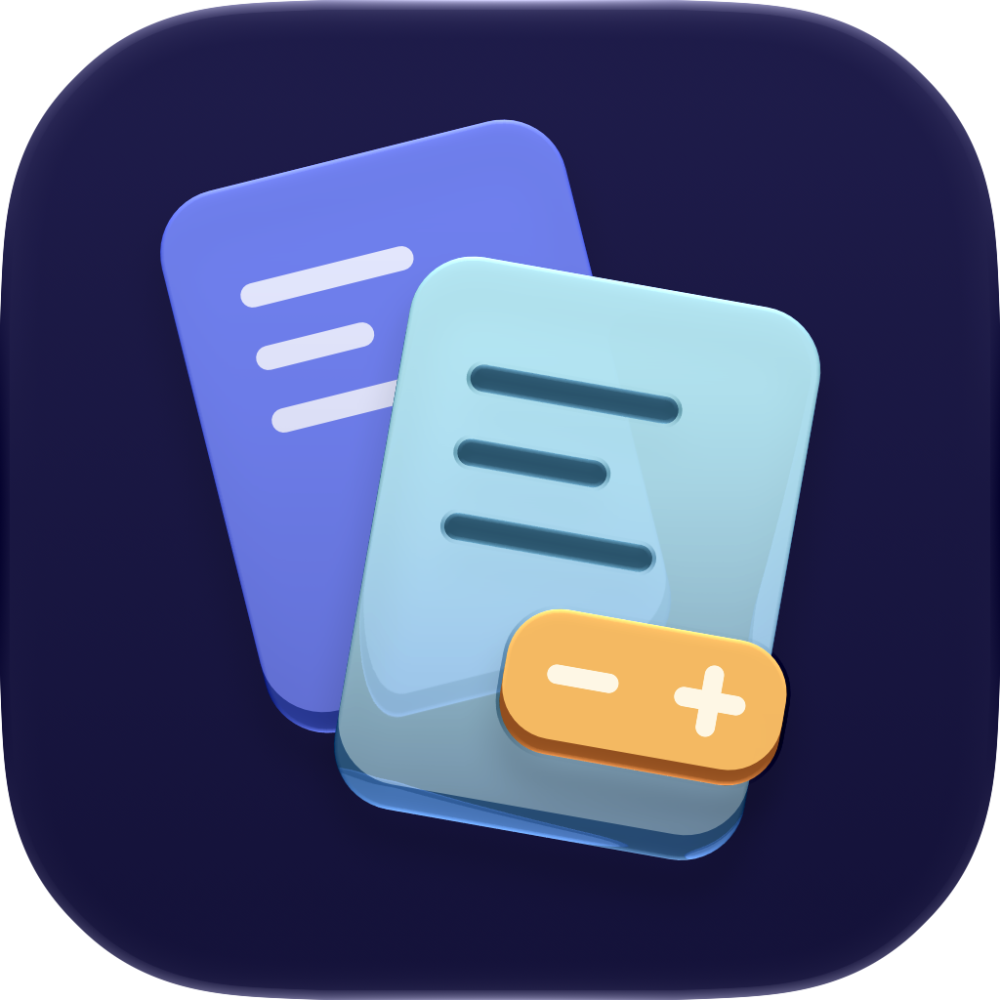

<p align="center">
  
</p>

# EntitlementDiff

**See what changed in a macOS app's declared entitlements.**

EntitlementDiff is a native SwiftUI app and a set of Swift libraries for comparing
embedded entitlements between two builds. Choose a Previous and Current `.app`,
select **arm64** or **x86_64**, and review added, removed, changed, and unchanged
keys with their exact typed values. The inspected apps are never launched.

Use it to review signing-configuration changes, check your builds before a
release, or share a comparison that a colleague can reopen without the original
apps.

**[Download the app](https://github.com/jdotc1/EntitlementDiff/releases/latest)** ·
**[Build from source](#build-from-source)** ·
**[See an example report](Examples/example-report.txt)** ·
**[Report an issue](https://github.com/jdotc1/EntitlementDiff/issues)**

The published app is for Apple silicon with a macOS 14+ deployment target. Release
notes identify the Developer ID signed, hardened, notarized app and source
archives. Intel-host and minimum-OS runtime acceptance remain outside the recorded
checks; see [validation and limits](#validation-and-limits).

> **What the comparison means:** declarations from the requested architecture of
> the **main executable only**. EntitlementDiff does not establish effective
> permissions, verify signatures, assess Gatekeeper/notarization, audit nested
> code, or assign a security verdict. Unknown entitlement keys remain visible.

## Try a comparison

1. Open EntitlementDiff and choose **Load Synthetic Example** to explore the
   interface without reading an installed app. The example has five changes and
   one unchanged key and is labelled as synthetic in the interface and exports.
2. For your own builds, choose the requested architecture, then select Previous
   with **Command-1** and Current with **Command-2**. You can also drop one local
   `.app` onto either pane.
3. Select a key to inspect its Previous and Current values. Use **All Changes**,
   search, or the **Show** picker to focus the table; **All Keys** includes
   unchanged entries. **Previous Change** and **Next Change** step through the
   visible changes and reveal their typed details.
4. Use **Copy Report** for a readable change report or **Export JSON** for both
   complete snapshots and every change. Review names, identifiers, and values
   before sharing.

Both apps must contain the selected architecture and readable signing metadata;
ad-hoc signatures are accepted. Unsigned, unsupported, and unreadable inputs show
errors. Multiple dropped items, web URLs, and non-app files are rejected. The
synthetic example is a demonstration, not a recommended entitlement configuration.

## Review the details

### Find and organize keys

Search filters raw key text. The Show picker isolates Added, Removed, Changed,
or Unchanged entries. Category counts describe the full comparison; the shown
count reflects the category and search together. Click **Change** or
**Entitlement** to sort and click again to reverse. Key sorting preserves UTF-8
byte identity.

**Previous Change** and **Next Change**, also in the Comparison menu, follow the
current visible sort order and respect search/category filters. They skip
unchanged rows in All Keys; from an unchanged selection they move to the nearest
change in the requested direction. With no visible selection, Next starts at the
first change and Previous at the last. Navigation stops at endpoints without
wrapping, and unavailable directions are disabled. The position indicator
describes changes in the current view; full counts and complete reports are
unchanged. This navigation is included in
[v0.1.12 (build 13)](https://github.com/jdotc1/EntitlementDiff/releases/tag/v0.1.12).

**Find Entitlement…** (**Command-F**) looks up a complete key by UTF-8 bytes.
A hidden match offers **Show in All Keys**; a missing match preserves the current
filters and selection. **Copy Exact Key**, beside the selected detail or in the
Comparison menu, copies the complete raw key without display escaping or preview
limits. It is unavailable when no row is selected.

**Reset View** clears search and restores All Changes with ascending key order.
Selection survives sorting and filters that keep its row, and clears when the row
leaves the view. Empty-result guidance distinguishes zero-key snapshots, matching
values, empty categories, and search-hidden keys. **Clear Search**, **Show All
Changes**, and **Show All Keys** change only the preferences named by the action.

### Inspect nested and long values

The selected-entitlement inspector expands dictionaries and positional arrays,
showing typed values and change labels for each path. Search reaches through
collapsed descendants; **Changes only**, **Previous Page**, and **Reveal More**
help navigate the inspected portion. **Nested Example** loads a separate
synthetic demonstration.

| View | Behavior and limits |
| --- | --- |
| Nested search | 50 rows per page, 2,000 inspected nodes, 12 levels, and 256 Unicode scalars per preview. Scan/depth limits are explicit; paging does not bypass them. |
| **View Value…** | A focused Previous/Current sheet for a scalar leaf. Strings page in 512 Unicode scalars; data pages in 768 bytes displayed as base64. First/Previous/Next/Last controls show page counts. Literal string search reveals and highlights the current match, with guidance when it continues across pages. |
| **Browse Branches** | Up to 50 immediate children per step, including values beyond the search traversal limit. Open Branch descends; Up restores the parent page; First/Previous/Next Children pages siblings. Arrays also offer a zero-based Go to Index. |

**Copy Selected JSON** retains the complete selected entitlement as tagged values,
independent of search, paging, or expansion. Each side's **Copy Leaf JSON** copies
its complete original typed scalar; absent or container sides cannot be copied
as leaves. The focused sheet captures its values when opened and disables source
actions until closed. Close the sheet to use whole-entitlement copying.

Branch browsing preserves exact Previous/Current pairs without recursively
searching or comparing descendants. **Back to Search** restores the bounded
search view and its incomplete-search notice. Replacing inputs, swapping sides,
or selecting another entitlement resets captured branch navigation. Inspector
projections are reused across unrelated view updates and replaced when their
comparison or selected entitlement changes; no measured speedup or bound on full
recursive equality is claimed.

### Refresh and identify inputs

**Reload** rereads a selected app after rebuilding it at the same path. A failed
input offers **Retry**. **Reload Both** in the toolbar or Comparison menu
(**Shift-Command-R**) refreshes both live selections using the explicit
architecture. Old results disappear immediately; failures keep the URL for retry.
Reload is unavailable for synthetic or saved inputs and during reads or report
operations.

**Swap** reverses comparison direction. Changing architecture clears both inputs
so that you choose each slice explicitly. Replacing or clearing an input
invalidates the old report immediately, even if an earlier read finishes later.
Missing, loading, and failed inputs are named in the waiting view, with direct
choose/retry actions where available. Failed inspection never becomes an empty
comparison.

**Input Details** separates bundle and signing identifiers, shows version/build
and the session-only selected location, and offers **Reveal in Finder**. Optional
metadata is bounded and unverified. Report schema 1 excludes this identity
metadata and selected locations.

## Save, reopen, and share comparisons

**Export JSON** writes schema-1 reports containing both full snapshots and all
changes, regardless of table filters. **Copy Report** includes the complete
change report. Reports omit source file URLs but include potentially sensitive
app names, signing identifiers, and entitlement values. Export into a selected
app bundle is rejected.

Open **Saved Report…** (**Command-O**), or use **Finder → Open With →
EntitlementDiff** on one local JSON report. Review the saved snapshots before
choosing either action:

| Action | Result |
| --- | --- |
| **Use as Previous** | Adopt one snapshot as Previous, select its saved architecture, and clear Current. Choose a Current app for a fresh inspection against that baseline. |
| **Open Saved Comparison** | Open both saved snapshots immediately. Either side can later be replaced with a live app. |

Saved snapshots are labelled **unverified metadata**, retain no original app
location, and have no Reload/Reveal action. Results are recomputed from their
values. Imports are bounded to 8 MiB, 96 JSON levels, 100,000 JSON nodes, and
1 MiB per decoded string.

Cancel and invalid input preserve the current comparison. Finish an active
panel, export, or review before opening another report; busy requests are
declined rather than queued. Finder opening supports one local report, including
cold launch, and uses the same bounded review path as the picker. JSON is
registered as an alternate viewer without changing the system default app.

## Find an exact child key

Browse Branches offers Find Child Key in dictionary branches. Enter the raw key
without JSON quotes; matching preserves exact UTF-8 bytes, case and whitespace.
A separate typed match leaves the current child page unchanged and supports Open
Branch or View Value. Up restores the parent page. Editing or changing the branch
clears the match. Lookup searches immediate keys without scanning descendants.
Included in v0.1.13 (build 14). See [Exact child lookup](docs/EXACT_CHILD_KEY.md).

## Exact-key input fidelity

Find Entitlement preserves raw UTF-8 edits, including changing between composed
and decomposed Unicode spellings. Editing clears prior lookup feedback; Find and
Show in All Keys use the current key. Initial focus, Return and Escape remain
available. Included in v0.1.14 (build 15). See [Input correction](docs/UTF8_FIND_INPUT.md).

## Jump to a focused value page

Each Previous/Current pane in Focused Value offers Page number and Go, with Return
submission and a valid one-based range. Invalid input leaves the page unchanged;
existing paging buttons synchronize the field. Each side navigates independently,
and reopening starts at page1. Rendering bounds and complete leaf copying remain
unchanged. Included in v0.1.15 (build16). See [Page navigation](docs/LEAF_PAGE_JUMP.md).

## Copy a complete branch

Browse Branches offers Copy Previous Branch JSON and Copy Current Branch JSON for
the current array or dictionary, including children outside the displayed page.
Empty containers are valid; absent/scalar sides are disabled. The clipboard holds
a complete tagged value fragment, not a saved comparison report. Encoding runs
off-main with revision/selection guards. Included in v0.1.16 (build17).
See [Branch copying](docs/COPY_BRANCH_JSON.md).

## Jump to an ancestor branch

Browse Branches offers Root and a compact Ancestors menu with up to12 nearest
non-root ancestors. A jump restores the saved parent child page and clears lookup
input. Opaque frame identities reject stale destinations; comparison replacement
resets navigation. Included in v0.1.17 (build18).
See [Ancestor navigation](docs/ANCESTOR_NAVIGATION.md).

## Find text inside focused strings

Each string pane in Focused Value offers literal UTF-8 Find and overlapping Find
Next. Find Previous searches backward from the current match, with explicit
Continue Backward steps and a nonwrapping beginning. Search runs in explicit32KiB steps; Continue Search examines more without
raising rendering limits. Matches navigate to the original start page and show
byte position. Raw edits and dismissal invalidate pending results. Data/base64
search is excluded. Included in v0.1.18 (build19).
See [Focused string search](docs/FOCUSED_STRING_SEARCH.md).

## Find the first difference in focused strings

When both focused values are strings, **Find First Difference** compares their
original Unicode scalars without normalization. **Continue Comparison** examines
another bounded portion. A found difference reveals both panes, with an explicit
end marker when one string is a prefix of the other. **Reveal Difference** returns
to that location while preserving each pane's independent Find query and results.
Each side shows the exact differing U+ code point, Unicode escape and UTF-8 bytes;
a prefix ending is labelled End of string without an invented code point.
This locates the first differing scalar; it does not align insertions or produce
a complete text diff. Reports and complete typed copies are unchanged.

## Find the first difference in focused data

When both focused values are data, **Find First Difference** compares their
original bytes. **Continue Comparison** examines another bounded portion; a found
difference navigates both panes to their existing base64 pages and shows each
exact hexadecimal byte or **End of data**. Positions are one-based original byte
positions. **Reveal Difference** returns to those pages without recomputing.
Base64 characters are not highlighted as individual bytes. Complete typed copies,
saved provenance and path-free schema-1 reports are unchanged.

## Build from source

Requires macOS 14+, a Swift 6 toolchain, and macOS command-line developer tools.
The package has no external package dependencies. Development builds need no
credentials or administrator access.

```sh
git clone https://github.com/jdotc1/EntitlementDiff.git
cd EntitlementDiff
./script/build_and_run.sh
```

The script builds, stages, ad-hoc signs, and opens `dist/EntitlementDiff.app`.
It stops only this checkout's staged app before rebuilding. Use the bundle when
running the GUI; a bare `swift run` executable is not the supported launch path.

```sh
./script/verify.sh
./script/build_and_run.sh --build-only
CONFIGURATION=release ./script/build_and_run.sh --build-only
```

`--build-only` stages without launching. `--verify` checks that the staged process
appeared, not that its interface or inspection behavior works. `--debug` starts
LLDB; `--logs` streams the app's system process logs. Release configuration produces
an optimized **development** bundle. Local builds are ad-hoc signed and are not
Developer ID signed, hardened, sandboxed, or notarized distribution builds.

Open [Package.swift](Package.swift) in Xcode for editing and debugging. The
SwiftPM manifest is canonical; no generated `.xcodeproj` needs synchronization.

## Use the Swift libraries

| Module | Responsibility |
| --- | --- |
| `EntitlementDiffCore` | Typed property-list values, bounded Foundation conversion, snapshots, comparisons, and deterministic tagged JSON/text reports. |
| `EntitlementDiffModel` | Session state and an injectable asynchronous reader. |
| `EntitlementDiffSecurity` | The macOS Security.framework adapter. |

```swift
import EntitlementDiffCore

let previous = EntitlementDictionary(["example.flag": .boolean(false)])
let current = EntitlementDictionary(["example.flag": .boolean(true)])
let comparison = EntitlementComparison(previous: previous, current: current)
assert(comparison.changes.first?.kind == .changed)

let example = ExampleSnapshots.pair(architecture: .arm64)
let report = try ComparisonReport(previous: example.previous, current: example.current)
let json = try report.jsonData()
```

The macOS reader is an actor conforming to `SnapshotReading`:

```swift
import Foundation
import EntitlementDiffSecurity

let reader = SecurityEntitlementReader()
let applicationURL = URL(fileURLWithPath: "/path/to/YourApp.app")
let snapshot = try await reader.read(at: applicationURL, architecture: .arm64)
```

The reader accepts conventional local-file-URL `.app` bundles with a Mach-O main
executable. A file URL may still point to network-mounted storage.

## Comparison and report contract

Booleans, integers, real numbers, strings, data, dates, arrays, and dictionaries
remain distinct. Absence differs from `false`; an absent dictionary representation
differs from a present, empty dictionary. Dictionary order is ignored, while
array order and multiplicity are preserved. Keys and strings use UTF-8 byte
identity rather than Swift's Unicode canonical-equivalence equality.

Reports use tagged values. Integers are decimal strings to avoid loss in JSON
consumers limited to 53-bit numeric precision. Dictionary entries are sorted
arrays so differently encoded Unicode keys do not collapse. See the
[report format](docs/REPORT_FORMAT.md), [JSON schema](docs/report.schema.json),
and [examples](Examples/).

Comparison uses values returned by the system decoder, rather than original
signature/DER/XML bytes; it cannot recover upstream normalization or information
loss. Library callers must provide finite real/date values because JSON encoding
rejects nonfinite values.

## Security, privacy, and validation limits

The production reader calls public Security/CoreFoundation APIs directly and
contains no shell, subprocess, plug-in loader, or target-code execution. No custom
history, telemetry, network client, updater, or background scanner is implemented.
macOS may keep its own panel/recent-location metadata and system logs.

Successful extraction **does not establish signature validity**. Apple's API can
return partial information from unverified signing data. Inspection is not an
atomic filesystem snapshot or hardened isolation for actively hostile inputs:
concurrent writes can defeat filesystem preflights, decoder budgets do not bound
Apple's earlier parser allocations, and cancellation cannot forcibly interrupt a
synchronous operating-system call. Use this release with developer-controlled
builds. [Sources and rationale](docs/SOURCES.md) explain these boundaries.

### Validation and limits

[Release validation](docs/RELEASE_VALIDATION.md) and
[macOS acceptance](docs/MACOS_ACCEPTANCE.md) record the accepted baseline, focused
checks, reused evidence, and remaining limits. Read the relevant release notes
for the specific downloaded app. Existing evidence does not establish clean-Mac,
minimum-macOS-14, or Intel-host runtime acceptance; a process-launch check is not
interface acceptance.

## Documentation and contribution

- [Design](docs/DESIGN.md) and [comparison browser](docs/COMPARISON_BROWSER.md)
  describe presentation and navigation.
- [Previous/Next Change](docs/CHANGE_NAVIGATION.md) details sequential review and
  its focused acceptance evidence.
- [Focused values](docs/FOCUSED_VALUE.md), [branch navigation](docs/BRANCH_NAVIGATION.md),
  and [saved comparisons](docs/SAVED_COMPARISON.md) document the detailed contracts.
- [Publishing](docs/PUBLISHING.md) describes source packaging and release preparation.
  There is no automatic hosted CI or publication workflow.
- [Issues](https://github.com/jdotc1/EntitlementDiff/issues) are the place for a
  reproducible problem or a proposed improvement. Include the app version,
  requested architecture, and observed behavior; use synthetic or shareable
  examples and review reports for sensitive metadata first.

Licensed under [MIT](LICENSE).

Focused string search reveals and highlights the current match within its bounded
page, including successive occurrences on the same page. Cross-page matches show
continuation guidance. Raw UTF-8 identity, complete copied values and reports are
preserved. Included in v0.1.19 (build20).

Find Previous in Focused String Values is included in v0.1.20 (build21), retaining exact UTF-8 matches, overlapping occurrences, bounded backward continuation and explicit beginning-of-string feedback.

Find First Difference in Focused String Values is included in v0.1.21 (build22), preserving exact Unicode scalar identity, bounded comparison and independent Find state.

Exact Unicode Difference Details is included in v0.1.22 (build23), with original scalar/EOF metadata, explicit escapes and exact UTF-8 bytes. The arm64 app is Developer ID signed, notarized and stapled.

Release v0.1.23 adds first-difference navigation for focused data values: exact original bytes, explicit continuation, hexadecimal byte/EOF details and independent base64 page reveal.

Focused data differences also show bounded hex context: up to16 original bytes
before and after the marked byte, exact one-based positions, and explicit [EOF]
versus [00]. The complete original values remain available through typed copies
and reports; the base64 pages retain their existing navigation.

Find Next Difference advances through focused data mismatches without rescanning
the prefix. Long equal intervals require explicit continuation; the last byte and
hex context remain visible while paused. Completion stops without wrapping and
keeps the last result available to reveal. Find First Difference restarts.

Focused string values support Find Next Difference with exact Unicode details
and separate Previous/Current UTF-8 byte positions. Long equal spans require
explicit continuation. Next stops without wrapping; Find First Difference restarts.
Literal text Find remains independent, and comparison never normalizes text or
infers insertion/deletion alignment.

Previous Found Difference revisits up to64 discovered string/data differences.
Next replays saved results before resuming the frontier scan. Retention limits
are explicit, and restart/dismissal clears history. Saved Unicode/byte details,
page reveal and bounded data hex context remain exact.

Go to found difference jumps directly to a retained string/data result by ordinal.
The displayed range includes only discovered, retained results. Invalid or discarded
ordinals leave the current result unchanged; Next preserves the original frontier.

Copy Difference Details copies the currently displayed found string/data mismatch
as a compact path-free text summary, preserving exact Unicode/byte details and
bounded hex context. It follows Previous and Go to found difference without rescanning.

Go to Byte in each focused data pane inspects a known1-based byte position or
EOF with bounded original hex context. Manual navigation leaves the selected
difference and Copy Difference Details unchanged; Reveal Difference returns to it.

Copy Byte Context copies a pane’s last successfully viewed byte position or EOF
and bounded original hex context. Pending edits and invalid positions do not
change it; Copy Difference Details continues to describe the selected mismatch.

Go to Scalar in each focused string pane reveals a1-based original Unicode scalar
or EOF with exact code-point and UTF-8 details. Manual navigation keeps literal
search and selected-difference state independent; Reveal Difference returns to it.

Copy Scalar Details copies a pane’s last successfully viewed original scalar or
EOF with exact Unicode and UTF-8 details. Pending edits and invalid positions do
not change it; selected-difference copying retains its separate meaning.

Previous Scalar and Next Scalar inspect neighbors of a manually viewed scalar,
crossing pages and reaching EOF without wrap. Exact UTF-8 details and copied
scalar content follow the step; search and selected-difference state stay separate.

Previous Byte and Next Byte inspect neighbors of a manually viewed data byte,
crossing pages and reaching EOF without wrap. Original context and copying follow
the step; selected differences and their copied details remain separate.
